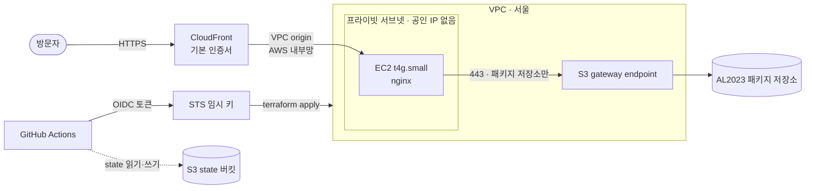

# aws-infra-portfolio

> Cost-capped AWS infrastructure with Terraform


AWS Cost Explorer 기준

- 주소: https://d2x05xzjhjvp9j.cloudfront.net

## 구조



## 쓰지 않은 것 ↔ 대신 쓴 것

| 쓰지 않은 것 | 대신 쓴 것 | 이유 |
| --- | --- | --- |
| S3 정적 호스팅 | EC2 + nginx | 정적 페이지만이라면 S3가 더 싸고 단순하다. 서버를 직접 운영하는 모습을 보여 주려고 일부러 서버를 두었다. |
| NAT Gateway | S3 gateway endpoint (패키지 저장소만) | 밖에서 받을 것은 OS 패키지뿐이라 무료 출구 하나면 충분하다. |
| ALB | CloudFront VPC origin | 서버가 한 대라 부하 분산이 필요 없고, HTTPS는 CloudFront가 맡는다. |
| 서버 공인 IP | 프라이빗 서브넷 + CloudFront에서 80번만 | 서버에 직접 닿는 길을 없애고 공인 IPv4 요금도 아낀다. |
| 저장소에 넣는 AWS 키 | OIDC 임시 키 (main만) | 오래 사는 키 없이, main에서 배포할 때만 임시 키를 받는다. |
| 도메인 + ACM 인증서 | cloudfront.net 기본 인증서 | v1은 동작 증명이 목표라 기본 주소로도 HTTPS는 충분하다. |

## 알고 있는 한계 → 다음 계획

| 지금의 한계 | 다음 계획 (v2) |
| --- | --- |
| 배포 권한이 AdministratorAccess | 필요한 권한만 남기기 |
| main에 push하면 리뷰 없이 바로 apply | PR에 plan 댓글 + PR용 읽기 전용 역할 |
| bootstrap state가 내 컴퓨터에만 있음 | S3로 옮기기 |
| 비용을 쓰고 나서야 확인함 | PR마다 비용 미리 보기 (Infracost) |

## 폴더 구조와 실행

```text
aws-infra-portfolio/
├── bootstrap/          ① 처음 한 번, 내 컴퓨터에서 직접
│   ├── main.tf         state 버킷 (장부 보관함)
│   └── oidc.tf         GitHub Actions가 들어올 문 (OIDC 역할)
├── infra/              ② main에 합쳐지면 GitHub Actions가 자동 적용
│   ├── network.tf      VPC · 프라이빗 서브넷 · S3 지름길
│   ├── server.tf       EC2 · 방화벽
│   └── cdn.tf          CloudFront · VPC origin
└── .github/workflows/
    └── deploy.yml      ②를 적용하는 배포 파이프라인
```

①은 처음 한 번만 실행하고, 그 뒤로는 main에 합칠 때마다 ②가 자동으로 적용됩니다.
